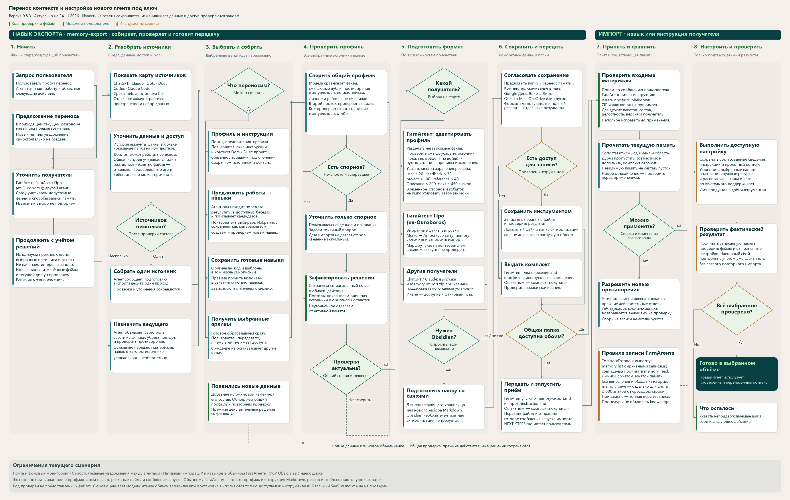

# Portable Agent Memory

**Два навыка для переноса контекста между ИИ-агентами: экспорт и импорт.**

Переносите сведения о себе, правила общения и работы, инструкции проектов, полезные материалы и собственные навыки. Цель — помочь настроить нового агента под пользователя, сохранив важные сведения и проверив дубли, противоречия и актуальность.

**[Скачать экспорт](https://github.com/innavosko/portable-agent-memory/releases/latest/download/memory-export.zip)** · **[Скачать импорт](https://github.com/innavosko/portable-agent-memory/releases/latest/download/memory-import.zip)** · **[Открыть SVG-схему](docs/diagrams/user-journey.svg)**

Версия **0.8.3** · [Все файлы выпуска](https://github.com/innavosko/portable-agent-memory/releases/latest) · [Установка и запуск](docs/WEB_SETUP.md)

## Зачем это нужно

- **Собрать контекст из нескольких агентов.** Один ведущий агент объединяет доступные данные ChatGPT, Claude, Dots, Duet, Codex и Claude Code. Веб, десктоп и место хранения файлов учитываются отдельно.
- **Перенести важное.** Пользователь выбирает сведения, проекты, переписки и навыки. Экспортёр предлагает полезные работы для переноса и помогает оформить повторяемые процедуры в навыки.
- **Сохранить правила и происхождение.** Инструкции проектов, пользовательские предпочтения и исходные файлы остаются связаны с источниками. Подключённые навыки включаются, если доступны их файлы и пользователь выбрал их для переноса.
- **Проверить общий профиль.** Агент сопоставляет смысловые дубли и противоречия, проверяет актуальность. Новый источник запускает повторную проверку; действительные ответы пользователя сохраняются.
- **Подготовить файлы для получателя.** Формат и состав экспорта зависят от возможностей принимающего агента. До применения импортёр проверяет пакет и сопоставляет его с доступной памятью получателя.

## Что скачать

| Навык | Назначение | Кому передать |
| --- | --- | --- |
| [memory-export.zip](https://github.com/innavosko/portable-agent-memory/releases/latest/download/memory-export.zip) | Собрать, проверить и упаковать контекст | Агенту-отправителю; при нескольких источниках — ведущему агенту |
| [memory-import.zip](https://github.com/innavosko/portable-agent-memory/releases/latest/download/memory-import.zip) | Проверить выгрузку и помочь настроить получателя | Принимающему агенту с поддержкой этого навыка и выполнения кода |

Каждый навык содержит инструкции, справочники и программу. Для одной роли достаточно одного ZIP. Экспортёр также содержит установщик импорта для передачи получателю; автоматически второй навык не устанавливается. **В установщиках нет вашего профиля:** файлы с личными данными создаются отдельно при экспорте.

## Как начать

1. Скачайте **memory-export.zip** и установите навык в среде агента, поддерживающей навыки, чтение файлов и выполнение Python 3.10+. Если установщик принимает папку, извлеките ZIP и передайте всю папку навыка.
2. Напишите: **«Используй memory-export. Помоги перенести мой контекст в [название агента]»**. Агент уточнит источники, объём переноса, получателя, место сохранения и наличие Obsidian; предложит отобрать важные работы.
3. Передайте доступные исходники и проверьте предложения агента. При нескольких источниках ведущий агент сводит общий профиль; устанавливать навык во всех источниках необязательно.
4. Получите выгрузку и инструкцию **NEXT_STEPS.md**. Передайте перечисленные файлы получателю через общую папку или вручную и отправьте готовое сообщение запуска импорта.

Загрузка ZIP в обычный чат сама по себе не устанавливает навык. Если постоянная установка недоступна, способы запуска полного комплекта в текущем чате и требования к инструментам описаны в [инструкции](docs/WEB_SETUP.md).

## Особенности получателей

| Получатель | Что ему передать |
| --- | --- |
| ChatGPT, Claude и другие агенты с подходящими инструментами | Выгрузку и отдельный навык **memory-import**. Возможность установки, выполнения кода и записи памяти проверяется в выбранной среде |
| **ГигаАгент** | **Только два отдельных Markdown-файла:** `client-memory-export.md` и `import-instruction.md`, плюс готовое сообщение запуска. Обычный ГигаАгент не принимает ZIP и навыки |
| **ГигаАгент Про (ex-Ouroboros)** | Выбранные файлы выгрузки; предусмотрен маршрут через **Меню → Amberkeep carry memory**. Этот маршрут пока не проверен в реальном аккаунте |

Для обычного ГигаАгента экспортёр **разделяет смешанные записи на самостоятельные сведения**, сохраняет максимум подтверждённых фактов в допустимых категориях и до выдачи файлов показывает исключения с причинами. Намерение не превращается в привычку, а правило проекта — в общее предпочтение. [Правила адаптации](docs/GIGA_ADAPTATION.md).

## Схема пути пользователя

[](docs/diagrams/user-journey.svg)

[Редактируемый SVG](docs/diagrams/user-journey.svg) · [Скачать SVG](https://github.com/innavosko/portable-agent-memory/releases/latest/download/user-journey.svg)

## Что важно учитывать

- **Код обрабатывает предоставленные файлы.** Он не получает автоматически доступ ко всем чатам, памяти, дискам или настройкам по факту установки навыка.
- **Смысловую работу выполняет модель агента.** Python проверяет структуру, полноту отчётов, их связь с текущими данными и целостность пакета. Программная проверка не гарантирует безошибочность выводов модели.
- **Фонового переноса между облаками нет.** Если оба агента не видят одну папку, пользователь копирует файлы и сообщает получателю о готовности. Obsidian необязателен; сам по себе он не подключает агентов друг к другу.
- **Созданный пакет ещё не означает завершённую настройку.** Запись долгосрочной памяти, установка навыков и подключение почты, календаря или диска требуют соответствующих инструментов принимающего агента и проверки результата.
- **Личный контекст не нужно публиковать в этом репозитории.** Для рабочих данных используйте отдельную папку; `private/`, `work/`, базы состояния и обычные ZIP исключены из Git.

## Проверки и документация

Локально на Windows выполнено **453 теста: 450 пройдены, 3 пропущены из-за ограничений платформы**. Отдельно проверены самостоятельный запуск обоих навыков, состав установщиков, подготовка файлов для получателей и предварительный обзор для ГигаАгента. Использованы вымышленные данные. Проверка установки и записи памяти в реальных веб-аккаунтах требуется отдельно.

[Результаты тестов](docs/TESTING.md) · [Состав установщиков](docs/PACKAGE_CHECK.json) · [GitHub Actions](https://github.com/innavosko/portable-agent-memory/actions)

- [Установка двух навыков](docs/WEB_SETUP.md)
- [Один ведущий агент и общая проверка](docs/AGGREGATE_REVIEW.md)
- [Завершение экспорта и передача получателю](docs/EXPORT_COMPLETION.md)
- [Адаптация памяти для ГигаАгента](docs/GIGA_ADAPTATION.md)
- [Передача через папки и облака](docs/CLOUD_DELIVERY.md)
- [Устройство, команды и демонстрации](docs/DEVELOPMENT.md)

## Для разработчика

Python **3.10+**, внешние зависимости для основного кода не нужны.

```sh
python -m unittest discover -s tests -v
python scripts/build_bundles.py
```

Сборка создаёт `dist/memory-export.zip` и `dist/memory-import.zip`. Общее ядро находится в `portable_memory/`; сборщик копирует его в оба навыка. Примеры в `examples/` — вымышленные. У ядра нет собственного вызова LLM API: анализ выполняет агент, который запускает навык.
